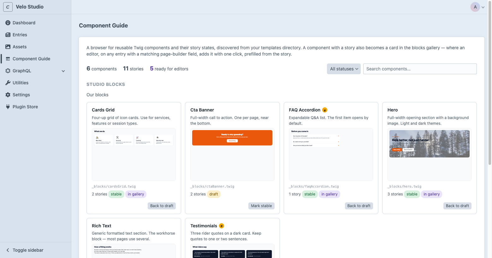
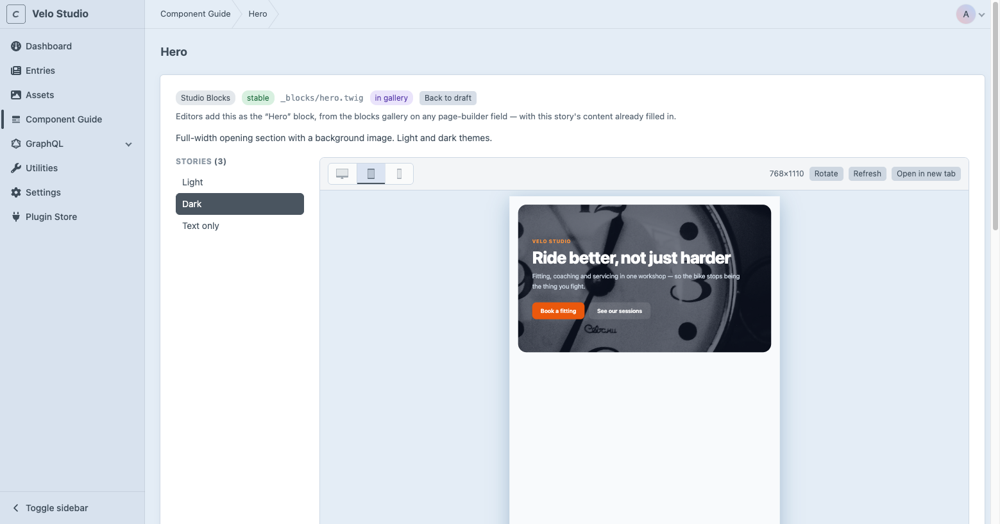
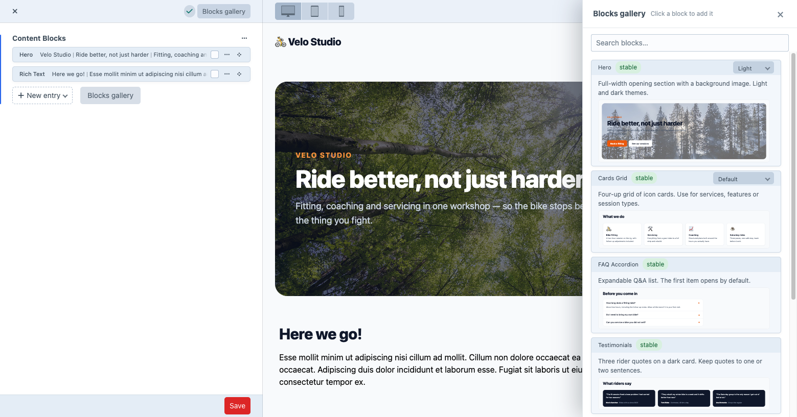
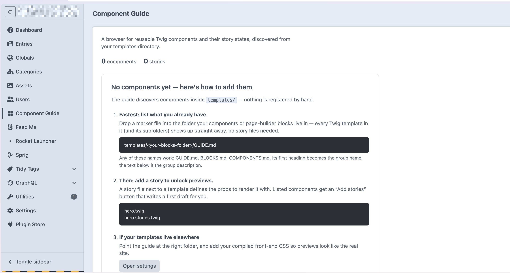

# Component Guide

[](https://github.com/b10k-nl/craft-component-guide/actions/workflows/ci.yml)

**Editors cannot tell which Matrix block is which.** They pick “Cards Grid” from a dropdown of names, hope it is the right one, and ask a developer when it is not. Component Guide shows them a rendered preview of every block a page-builder field accepts, inside the Craft control panel, and lets them add the one they picked.

For developers it is a **component library for Craft CMS** — a living style guide of every Twig component in the project, rendered with your site's own CSS and discovered from the templates you already have. No separate Storybook, no second environment to keep alive, no screenshots to maintain.

It also catches previews that lie: a story can promise a field the entry type does not have, and the guide says so before an editor meets a card they can never reproduce.







Nothing configured yet? The guide starts by explaining how to get there:



> **Status:** `1.8.0` — stable. **Lite is free**, on any site, including production. Pro is $99 per site plus $39/year for updates after the first year, and is free to run in development and staging. New to it? [GETTING-STARTED.md](GETTING-STARTED.md) is a five-minute walkthrough.

---

## Requirements

- Craft CMS **5.0+**
- PHP **8.2+**

## What it does

- Recursively discovers components from a configured templates folder.
- Supports nested (`button/button.twig` + `button/button.stories.twig`) and
  adjacent (`button.twig` + `button.stories.twig`) conventions.
- Two story languages (Twig and PHP) and two shapes (simple + rich),
  normalized to one internal model.
- Groups, lists and client-side-searches components in the CP.
- Renders each story in an isolated **iframe** with your front-end CSS, on a
  desktop, tablet or phone frame, cropped to the component's own height.
- Generates a copy-pasteable Twig `` snippet.
- Surfaces per-component errors without breaking the rest of the guide.
- Lists story-less templates via **marker files** (`GUIDE.md` / `BLOCKS.md` /
  `COMPONENTS.md`), so the guide doubles as a full component inventory.
- **Blocks gallery for editors:** a "Blocks gallery" button on every Matrix
  page-builder field (all view modes — blocks, cards, index) opens a panel of
  real component previews with descriptions; clicking one adds that block. In
  "Inline-editable blocks" mode the new block is prefilled with the story's
  own content, so it is visible on the page immediately. A block with several
  stories shows them in a dropdown on its card, or — with **Variants as cards**
  ticked — as one card per story, for stories that change the layout rather
  than a colour.
- **Editors' own variants:** "Save as my variant…" in a block's action menu
  keeps the block as the editor filled it, under a name, as a card of their own
  in the gallery. Personal, stored in their Craft user preferences — no table,
  no migration — and handed to a developer as a ready-to-paste story when it
  deserves to be one for everybody.
- **Works with block templates as they are:** a block template that reads the
  entry itself — `{{ block.heading }}`, `block.cards.all()`, `block.image.one().url`
  — previews from a story written in field handles; the guide builds the block
  it reads, in the shape Craft gives each field. No adapter needed to start.
- **Bulk setup with a coding agent:** a recipe in `AGENT-SETUP.md` any agent
  can follow to document an existing library in one pass — marker file, one
  draft story per component, and a report of the blocks that do not match an
  entry-type handle.
- **Promote from the control panel:** flip a reviewed component between `draft`
  and `stable` on its card, and the guide tells you which files it changed so
  nothing is written behind git's back.
- Persistent scan cache keyed by a filesystem fingerprint — invalidates itself
  the moment a story, template or marker changes.

## When not to use this

- **Your components query Craft themselves.** A component that runs its own
  element queries (`craft.entries…`) previews whatever those queries find, not
  what a story says. Reading the block it is given is fine — see
  [Block templates that read the block themselves](#block-templates-that-read-the-block-themselves).
- **You have no page-builder field.** The editor half is built around Matrix.
  Without one the guide is still a component browser, but the half that earns
  its keep sits idle.
- **You want screenshots you art-direct.** Previews are re-rendered from the
  template every time, so they cannot go stale — and cannot be posed either.
- **Your previews need CSS the guide cannot reach.** They are exactly as
  accurate as the stylesheet you point them at.
- **You need a verdict on every component.** The contract check gives none when
  it cannot identify a single adapter. Refusing beats guessing.

## Editions

**Lite is free.** Everything that tells you the truth about your own project is
in it:

- the component index, marker files and groups
- live previews rendered with your site's own CSS
- the contract check and its badge — a story promising a field the entry type
  does not have
- loud render errors, rather than a silent broken thumbnail
- the story scaffolder, including the whole-library pass
- the write journal

**Pro adds the things the plugin does on your behalf:**

- **inserting a block from the gallery** — an editor picks a card and the block
  lands filled in, from the state whose preview they were looking at
- **saving their own variants** — "Save as my variant…" on a block, and the
  card it becomes in the gallery (see below)
- **`stories/check`** — the contract check as a console command with an exit
  code, for CI. The edition comes from your committed `project.yaml`, so a CI
  runner reads Pro without needing a licence key of its own; under Lite the
  command explains itself and exits 0 rather than breaking your build

The blocks gallery opens in Lite too. Editors browse the real rendered cards for
the blocks a field accepts; only the click that inserts a filled-in block is
held back, and Craft's own “New Block” menu works exactly as it always did.

The split is *seeing* versus *acting*, not developer versus editor. A component
library you cannot see is the problem this plugin exists to solve, so seeing it
is not the part with a price on it.

In PHP and Twig:

```php
if (\b10k\componentguide\Plugin::getInstance()->isPro()) { … }
```

## Editors' own variants

The developer's stories are the starting points. An editor who keeps building
the same block the same way — the dark coaching hero, the two-plan pricing
table — can keep it:

1. Fill in a block on any entry as usual.
2. Open the block's action menu (⋯) and choose **Save as my variant…**.
3. Name it. The panel says which fields are kept before anything is saved.

The variant appears in the blocks gallery next to the block's stories, marked
★, with a live preview. Clicking it adds the block filled in exactly as saved.

**What is kept.** Only the fields the gallery can fill back in: those the
adapter passes to exactly one template argument — text, number, URL, email,
dropdown, radio buttons and lightswitches, up to 500 characters each. Rich text
(CKEditor), assets, relations and nested blocks are not kept and start from the
block's first story instead; the save panel names them. That rule is what keeps
a variant honest: its card previews exactly what a click puts back.

**Where it lives.** In the editor's own Craft user preferences — personal,
across sessions and devices, gone when the user is deleted. The plugin still
ships no migration and no table of its own. Nobody else sees an editor's
variants, developers included.

**Making it everyone's.** On the variant's gallery card, **Share with a
developer** copies it as a story entry in Twig — every argument written out —
for a developer to paste into the component's story file. That hand-over is
deliberate: preferences are personal and cannot be searched efficiently, and a
story in git is reviewed like any other change. **Delete** removes the variant.

Saving a variant is a Pro feature. It works in Matrix fields set to
**Inline-editable blocks**; Cards and Index modes have no block menu to add it
to.

## Installation

From the [Craft Plugin Store](https://plugins.craftcms.com/component-guide):
open **Plugin Store** in your control-panel sidebar and search for
“Component Guide”.

Or with Composer:

```bash
composer require b10k/craft-component-guide
php craft plugin/install component-guide
```

On DDEV, prefix each command with `ddev`.

New to it? [GETTING-STARTED.md](GETTING-STARTED.md) walks through the first
five minutes.

## Configuration

Settings can be edited in **Settings → Plugins → Component Guide**, or overridden
per-environment with a config file. The config file **wins**; any field it sets
is read-only in the CP.

`config/component-guide.php`:

```php
<?php

return [
    'componentPath' => '',                 // scan root, relative to templates/ ('' = whole dir)
    'storySuffix' => '.stories.php',
    'enableCpSection' => true,
    'enableIframePreview' => true,
    'previewCss' => ['/dist/css/app.css'], // string or array
    'previewJs' => ['/dist/js/app.js'],
    'previewTemplate' => '',               // site template rendered into the preview <head>
];
```

| Setting | Default | Notes |
|---|---|---|
| `componentPath` | `''` (whole `templates/`) | Scan root relative to `templates/`. Empty scans everything; set e.g. `_components` to narrow. No absolute paths or `..`. |
| `storySuffix` | `.stories.php` | Must end in `.php`. The Twig equivalent (`.stories.twig`) is derived from it automatically and discovered too — that's the format the scaffolder writes. |
| `enableCpSection` | `true` | Show/hide the CP nav item. |
| `enableIframePreview` | `true` | Isolated iframe vs. an "open preview" link. |
| `previewCss` / `previewJs` | `[]` | Front-end assets injected into the preview. |
| `previewTemplate` | `''` | A site template rendered into the preview document's `<head>` — the right place for Vite/manifest asset tags (see below). |

**The model is Storybook-style:** the scanner walks the scan root recursively and
shows *every* Twig template that has an adjacent story file — anywhere in the
tree (components, page-builder blocks, partials). A template's author opts it into
the guide simply by dropping a `*.stories.twig` (or `*.stories.php`) next to it;
nothing else registers it. Components are grouped by their folder path (or by a
story's `meta.group`).

## Directory conventions

```
templates/_components/
├── button/
│   ├── button.twig
│   └── button.stories.twig
├── card.twig                 # adjacent convention also works
├── card.stories.twig
└── navigation/menu/
    ├── menu.twig
    └── menu.stories.twig
```

A Twig file is listed as a component only when it has a matching story file —
unless its folder is opted in via a **marker file** (see below).
Hidden files/dirs, `node_modules`, `vendor` and cache folders are ignored.

## Marker files: components without stories

Writing a story per component is an upgrade, not the ticket in. Drop a marker
file — `GUIDE.md`, `BLOCKS.md` or `COMPONENTS.md` — into any folder inside the
scan root, and **every** plain Twig template in that folder and its subfolders
is listed in the guide, story or not. Story-less templates appear as inert
“undocumented” cards with a hint to add a story; templates whose filename
starts with `_` are treated as internal partials and skipped.

The marker is also lightweight documentation:

```md
# Content Blocks

Reusable page blocks editors can add through the Matrix page builder.

## Anything below the intro is ignored by the guide — document freely.
```

- The **H1** becomes the group label. Group names mirror the folder hierarchy:
  a marker's H1 replaces its own folder's name in the chain and plain
  subfolders are humanized (`Components / Cards`). Components without an
  explicit `meta.group` inherit the derived name, so documented and
  undocumented cards share one section.
- The **intro text** below the H1 (up to the next heading) becomes the group
  description on the index page.
- One marker per folder; with duplicates, precedence is
  `GUIDE.md` → `BLOCKS.md` → `COMPONENTS.md` and the CLI scan warns.
- Not listed as components: files starting with `_` (internal partials) and
  `index.twig` / `undefined.twig` (the dispatcher pattern's entry point and
  fallback). A story file next to any of them still documents it explicitly.
- Markers live in git next to your templates and read as plain folder docs on
  GitHub. The scan cache tracks them automatically.

## Story format

Stories come in two languages — **Twig** (`*.stories.twig`) and **PHP**
(`*.stories.php`) — with the same shape. Twig is the default: it's the language
the component is already written in, and it's what the scaffolder writes. Both
are discovered automatically; pick per component if you like.

### Twig

```twig



```

`meta` is optional — a file with just `stories` works. The story file is
rendered as a data-only template: set those two variables and output nothing.

### PHP — simple

```php
<?php

return [
    'Primary'   => ['label' => 'Save', 'variant' => 'primary'],
    'Secondary' => ['label' => 'Cancel', 'variant' => 'secondary'],
];
```

### PHP — rich (with metadata)

```php
<?php

return [
    'meta' => [
        'title' => 'Button',
        'group' => 'Atoms',
        'description' => 'Primary user-action button.',
        'status' => 'stable',
    ],
    'stories' => [
        'Primary' => [
            'args' => ['label' => 'Save', 'variant' => 'primary'],
            'description' => 'The default call to action.',
            'background' => '#f5f5f5',
            'viewport' => 'phone',
            'tags' => ['action', 'form'],
        ],
    ],
];
```

Optional story keys: `args`, `description`, `background`, `viewport`, `tags`.

- **`viewport`** picks the device the preview opens in — `desktop` (default),
  `tablet` or `phone`. The reader can still switch; this just says which state
  the story is really about, so a mobile-only variant doesn't open in desktop.
- **`background`** sets the colour behind the preview frame (any CSS colour),
  useful for components meant to sit on a dark or tinted section.

**Status vocabulary:** `stable`, `beta`, `draft`, `deprecated` (case-insensitive;
`wip`, `ready`, `experimental` and `legacy` are accepted as aliases). Only
`stable` components are addable from the blocks gallery — see below.

### Component example

```twig
{# templates/_components/button/button.twig #}




<button type="button" class="button button--{{ variant }}" disabled>
    {{ label }}
</button>
```

Prefer plain arrays and scalar props. Craft element objects returned by trusted
story files are not blocked, but arrays keep stories portable.

## Scaffolding stories

Undocumented components (see marker files above) can bootstrap their own
story. Each undocumented card gets an **Add story** button in environments
where Craft's `allowAdminChanges` is on (local and staging by convention — the
same gate Craft uses for its own project-file changes); elsewhere the guide
says so instead of hiding the feature. The equivalent on the command line is:

```sh
php craft component-guide/components/make hero            # writes hero.stories.twig
php craft component-guide/components/make hero --states   # one story per detected state
php craft component-guide/components/make hero --format=php
```

The scaffolder reads the template and guesses a `Default` story from it:

- root variables become args; `` becomes a three-item
  sample array carrying the keys the loop actually uses (`it.title` → `title`);
- `|default('…')` and the `` idiom supply real values;
- everything else is guessed by name — `*Url` → `#`, image-ish `*Url` → an
  inline SVG placeholder, `*Html` → a paragraph, `is*`/`has*` → `true`;
- the first sentence of the template's leading `{# … #}` comment becomes the
  component description.

**One story, or one per state.** If the template switches on a value —
`theme == 'dark'`, `mediaPosition == 'right'` — those comparisons are its
states, and a second button appears next to **Add story**: **Add 2 stories**
(however many it found), with a tooltip naming the values. Taking it writes
one story per value (`Light`, `Dark`, `Media right`…) instead of a single
`Default`, so the component's variants are documented from the start. Either
way it is one story file — the buttons differ only in how many stories go
inside it.

The result is a **draft**: it is written with `status: draft`, the args are
guesses, and an existing story file is never overwritten. Review it, fix what
the heuristics got wrong, and promote the status when the component is
properly documented.

## Documenting a whole library with a coding agent

Scaffolding one component at a time is fine for a handful. For a library that
already has forty templates, the format is documented well enough that an agent
can write the stories for you — so the package ships a recipe for exactly that:

```
Read AGENT-SETUP.md in vendor/b10k/craft-component-guide and follow it.
```

It is tool-agnostic — nothing in it names a particular agent — and it is a plain
Markdown file in the package root, so it is on disk as soon as Composer has run.
The recipe tells the agent to find the component folders and ask which to
document, read entry-type handles from `config/project/` rather than inventing
them, write one story per component (plus one per switchable state), use
placeholder tokens for what carries no information and real copy where the
story asserts something — and to stop there:

- it never renames a template or an entry type to force a gallery match; the
  mismatches go into its report instead, which is the most useful thing it hands
  back;
- it never touches your component templates or `config/project/`;
- it never commits — the diff is the point;
- **every story it writes is `status: draft`.** Only `stable` components are
  addable from the blocks gallery, so after an agent pass your own index is full
  of previews while editors see nothing new. That is deliberate: a generated
  story marked `stable` would be a claim nobody had checked.

Then you review — not by reading a large diff, but by looking. Open the guide,
scan the rendered previews, and the ones that came out wrong are the ones whose
args need a two-line fix.

## Reviewing and promoting

A component whose story is `draft` gets a **Mark stable** button on its index
card and on its own page; a `stable` one gets **Back to draft**. Both write the
one `status` line in the story file and leave every other byte of it alone, so
your comments, spacing and argument order survive.

Only those two statuses are toggleable. `beta` and `deprecated` say something
about a component's lifecycle that only a developer knows, so they stay in the
editor where you wrote them; the toggle is for the review verdict, which is the
one status change you make in bulk.

The same two gates as scaffolding apply (`allowAdminChanges`, and a writable
templates directory), so the button is absent — with a stated reason — on
read-only environments.

### What the guide changed

The control panel has no `git status`. So when it writes into `templates/` —
a scaffolded story, a promoted status — it says so: a notice on the index lists
the files it changed, until they are dealt with.

It only ever claims what it can still verify. Each entry records the content
hash of what was written, and is re-checked on every read: if the file's hash no
longer matches, someone edited or reverted it after the guide did, and the entry
is dropped. If `.git/index` is newer than the file, a `git add` or commit
happened since, and the entry is dropped. **Reviewed** drops it by hand. The
notice would rather miss a file than cry wolf — one that lies twice is one you
stop reading, and git remains the real safeguard.

The record lives in Craft's runtime storage, never in your repository.

## Placeholder tokens

Stories don't have to carry their own copy. Any string arg can be a token,
expanded when the preview renders:

```twig

```

| Token | Result |
| --- | --- |
| `@lorem` | a short phrase |
| `@lorem_w_12` | 12 words |
| `@lorem_s_3` | 3 sentences |
| `@lorem_p_2` | 2 paragraphs, wrapped in `<p>` |
| `@image` | a photo, 800×600 |
| `@image_1600x600` | a photo at that size |
| `@icon` | one of Craft's system icons |
| `@icon_star` | that specific system icon |

Three things worth knowing:

- **Deterministic.** Values are derived from the component, story and argument
  path — the same story always renders the same text, so previews don't
  flicker and gallery thumbnails match the detail page. Items in a list still
  differ from each other, so three identical `@lorem_w_4` tokens produce three
  different samples.
- **Offline-safe.** Photos come from an external service; if it can't be
  reached, the preview falls back to an inline placeholder of the same size.
  Icons are always inline (no network).
- **Unknown tokens pass through.** `@something` the plugin doesn't recognise
  is left exactly as written.

The story scaffolder emits these tokens, which is why generated stories stay
short and readable.

### What to tokenise — and what not to

Tokens exist to kill busywork, not meaning. A useful rule:

- **Tokenise what carries no information:** photography, icons, “just some
  paragraph of text” in a fresh scaffold, the third and fourth items of a list.
- **Write real copy where the story asserts something:** the flagship state
  you'd screenshot, and the edge cases you're documenting on purpose — a
  heading long enough to wrap, a button label that nearly overflows, a card
  with no image.

A preview full of lorem tells you the component renders. A preview with real
copy tells you it *works* — that the two-line heading still fits, that the
tone is right, that “Membership” doesn't break the button. That's also what
makes the guide worth showing to a client or a new teammate.

So: scaffold with tokens (one click, previews come alive), then replace the
values that are worth a human's attention. That's exactly what the `draft`
status is there to remind you of.

## Block templates that read the block themselves

Most Craft projects have no adapters: the page loops its Matrix field and
includes one template per block type, and that template reads the entry it is
handed:

```twig
{# _blocks/hero.twig #}

<section class="{{ block.theme.value == 'dark' ? 'bg-slate-900' : 'bg-white' }}">
    
    <h1>{{ block.heading }}</h1>
    {{ block.bodyText }}
</section>
```

That works without changing a line. Write the story in the entry type's **field
handles**, plainly:

```twig

```

A Matrix field takes a list of items in its nested entry type's handles —
`gridCards: [ { title: 'Bike fitting', cardText: 'Two hours on the rig.' } ]`
— and the template's `` loops them.

The guide notices the template reads a variable no story sets and nothing in
the template defines — `block` here, whatever your dispatcher calls it — and
builds that entry from the story, using the matched entry type's field types:
rich text prints as HTML, a dropdown has `.value` and `.label` and compares as
its value, assets and relations answer `.one()`, `.all()`, `|length` and loops,
Matrix items become entries of their nested type (name it with `type:
'handle'` when the field allows several), and `block.type.handle` and
`block.fieldLayout.getFieldByHandle()` work. The blocks gallery, prefill, the
contract check and editors' own variants all use the same field handles.

Limits, named here rather than discovered:

- **What the stand-in cannot answer, the preview says.** A field the entry type
  does not have, a method only a real element has, an image transform — the
  value is empty and a note under the preview lists it. Nothing is left out
  quietly.
- **Only when there is no adapter.** A component something else includes with
  plain values is presentational and renders as it always has. So does a story
  that sets the variable itself (`args: { block: { … } }`).
- **One template per entry type.** If the same entry type is rendered by two
  templates, the check reports fields the other one reads as unused.
- A template that reassigns its block variable in a loop — a dispatcher — is
  not treated as a block.

When a block grows, splitting it into an adapter and a presentational component
(below) is still where the guide does best — but it is a step you take when it
pays, not the price of trying the plugin.

## Recommended architecture: adapters + presentational components

The guide works with any template structure — including block templates that
read the block themselves (above) — but this three-layer pattern gets the most
out of it, and keeps a Matrix page builder maintainable:

```
templates/_v2/
├── _blocks.twig             # dispatcher — loops the Matrix field (~10 lines)
├── _adapters/               # entry-aware glue (NOT listed in the guide)
│   ├── hero.twig            #   one per block type, named after its handle
│   ├── promoBanner.twig
│   └── undefined.twig       #   fallback: dev/preview-only “unmapped block” alert
└── _blocks/                 # presentational components (listed in the guide)
    ├── BLOCKS.md            #   marker file — inventory + group description
    ├── hero.twig            #   pure: accepts scalars/arrays, never an Entry
    ├── hero.stories.twig    #   preview states for the guide
    └── promoBanner.twig
```

**Presentational components** accept plain scalars and arrays with `|default`
fallbacks — never a Craft element. That is exactly what makes them previewable
in the guide with simple array stories, and reusable outside the Matrix
context.

**Adapters** are the only layer that touches entries: one small template per
block type, receiving `{ block }`, doing all field access, `getFieldByHandle`
guards, image transforms, queries and fallbacks — then including the
presentational partial. They contain no markup of their own. Keep the folder
**outside** any marker-covered subtree so the guide never lists glue code as
components.

**The dispatcher** collapses to a loop with a convention-based include and an
automatic fallback (Twig picks the first template that exists):

```twig

    

```

`undefined.twig` renders a visible warning in dev mode / live preview and
nothing in production — a new block type shows up as an actionable alert
instead of silently rendering nothing.

Rules of thumb: a component never touches an Entry; an adapter never contains
markup; adding a block = entry type + adapter + component (+ story when it
earns one).

## Preview asset configuration

Set `previewCss` / `previewJs` (string or array of URLs) to load your compiled
front-end assets into the preview document. With none configured you get a clean,
unstyled document. CSS support matters most; JS is optional.

**Using Vite (or any manifest-based build)?** Static URLs go stale between dev
and production — point `previewTemplate` at a small site template instead, and
put your asset tags there. It is rendered into the preview document's `<head>`
in site mode, so helpers like `craft.vite` resolve the dev server vs. the
built manifest exactly like on the front end — previews get real styling *and*
working component JS (carousels included) in both environments:

```twig
{# templates/_component-guide-preview.twig #}
{{ craft.vite.script('src/js/app.ts') }}
```

```php
// config/component-guide.php
'previewTemplate' => '_component-guide-preview',
```

## Uninstalling

### 1. Remove the plugin

Either from the control panel — **Settings → Plugins → Component Guide → ⚙ →
Uninstall** — or from the command line:

```bash
php craft plugin/uninstall component-guide
composer remove b10k/craft-component-guide
```

That removes the plugin, its settings, its permission and its scan cache.

### 2. Decide what to do with your story files

They are **left in place on purpose.** A `*.stories.twig` next to a template is
inert without the plugin — nothing includes it, nothing renders it, it costs
nothing. A `GUIDE.md` is just a markdown file that reads as folder
documentation on GitHub. Keeping them means reinstalling later picks up exactly
where you left off.

If you do want them gone, delete them yourself — they're your files, in your
repository, and you should see the diff before it lands:

**In your editor (PhpStorm, VS Code, …)**

1. Search the project for `*.stories.twig` and `*.stories.php`
   (PhpStorm: <kbd>⌘⇧O</kbd> → type `.stories.` · VS Code: <kbd>⌘P</kbd> → same).
2. Review the list — some of these may be files you wrote or heavily edited.
3. Select and delete.
4. Search for `GUIDE.md`, `BLOCKS.md` and `COMPONENTS.md` inside your templates
   folder and delete those too, if you don't want them as folder docs.
5. Commit, so the removal is reviewable and revertable like any other change.

**In a terminal**

```bash
# preview first — nothing is deleted by this
find templates -name '*.stories.twig' -o -name '*.stories.php'

# then remove them through git, so the change is staged and revertable
git rm 'templates/**/*.stories.twig' 'templates/**/*.stories.php'
```

Marker files, if you want those gone too:

```bash
git rm 'templates/**/GUIDE.md' 'templates/**/BLOCKS.md' 'templates/**/COMPONENTS.md'
```

### What was never touched

Your content, your Matrix fields, your entry types, your templates. The guide
only ever *reads* them. The exceptions are story files, and only when you ask:
the **Add story** button (and its CLI equivalent) writes a new one and never
overwrites an existing one, and **Mark stable** / **Back to draft** rewrite the
single `status` line of one.

Editors' saved variants stay in their user preferences, under one key
(`componentGuide.stories`), unread by anything once the plugin is gone.

The scan cache can also be cleared on its own at any time, without uninstalling
anything: **Utilities → Caches → Component Guide scan cache**.

## Security & trust model

- Story files are **project code** — Twig templates or PHP files in your repo.
  Treat them like any other template. They are only ever discovered inside the
  configured `componentPath`.
- The scanner refuses absolute paths and `..` traversal; the resolved directory
  must live inside your templates folder.
- Previews render only component/story **IDs** resolved through the repository —
  a request can never supply a raw template path.
- Every CP/preview action requires login and the `component-guide:access`
  permission.
- The two actions that **write** into `templates/` — scaffolding a story and
  changing a status — are POST-only, CSRF-protected, and gated on
  `allowAdminChanges` plus a writable templates directory. A status change
  rewrites exactly one line. Every such write is recorded and surfaced on the
  index (see *What the guide changed*), because a control panel that edits
  project files silently is worse than one that cannot.
- Previews render in a separate iframe document, so project CSS and JS never
  mix with the control panel's. It is not a `sandbox`ed iframe: it shares the
  control panel's origin, which is how the gallery and the component page
  measure a preview's height. Metadata is escaped; error messages appear where
  `allowAdminChanges` is on, absolute paths and stack traces only in
  `devMode`.
- Editors' variants are read and written only for the signed-in user, in
  their own user preferences; no request can name another user's. Saving is
  POST-only and CSRF-protected, keeps only fields the block's adapter maps,
  and renders through the same preview as stories — a variant never supplies a
  template path or args of its own.

Do **not** expose the plugin to untrusted users — story files are project code,
not a sandbox.

## Troubleshooting

- **"No components found."** — check `componentPath` (relative to `templates/`)
  and that story files end in `storySuffix` (or its `.twig` equivalent). The
  index also walks you through this when nothing is discovered yet.
- **Component missing** — it needs a matching `*.twig` next to its story file.
- **Render error in preview** — the component threw; the message is shown
  wherever `allowAdminChanges` is on, and the full trace in `devMode`.
- **A story renders nothing** — usually markup behind a condition the args
  don't satisfy, or a template that reads Craft data itself; the preview says
  so instead of showing a blank frame.
- **Styles missing in preview** — set `previewCss`, or `previewTemplate` if you
  build with Vite.
- **No "Add story" button** — scaffolding writes files, so it needs
  `allowAdminChanges`; the index says so where that's off.
- **No "Blocks gallery" button** — the field's entry-type handles must match
  component names. Matching ignores case and separators (`inline-donation-form`
  ↔ `inlineDonationForm`), so the usual cause is a genuinely different name;
  open `component-guide/picker-map` to compare.

## Development

```bash
composer install
composer test       # PHPUnit (scanner, story parser, scaffolder, placeholders)
composer analyse    # PHPStan (level 5)
composer check      # both

npm install         # once (Node 22+)
npm test            # control-panel JavaScript: gallery prefill and cards (jsdom)
```

### CLI diagnostics

Run the same discovery the CP uses, to verify configuration without opening the
control panel:

```bash
php craft component-guide/components/scan
# DDEV:
ddev exec php craft component-guide/components/scan
```

## Roadmap

- **Page presets** — a developer-defined set of blocks (“service page”,
  “campaign landing”) an editor adds in one go, filled from the stories
- **Craft 6** — a 6.x release as soon as Craft 6 is stable
- Seeding scaffolded args from the matched entry type's field layout, so the
  draft comes from the schema instead of a guess

## Feedback

Bug reports, feature ideas and “this felt weird” notes are all welcome —
[open an issue](https://github.com/b10k-nl/craft-component-guide/issues).
[GETTING-STARTED.md](GETTING-STARTED.md) lists the current known limitations.

## Contributing

See [CONTRIBUTING.md](CONTRIBUTING.md). Report security issues privately (see
that file) rather than via public issues.

## License

[The Craft License](LICENSE.md) — the standard licence for commercial Craft
plugins: source-available, one licence per production environment. Lite is
free everywhere; Pro is free to run in development and staging.
